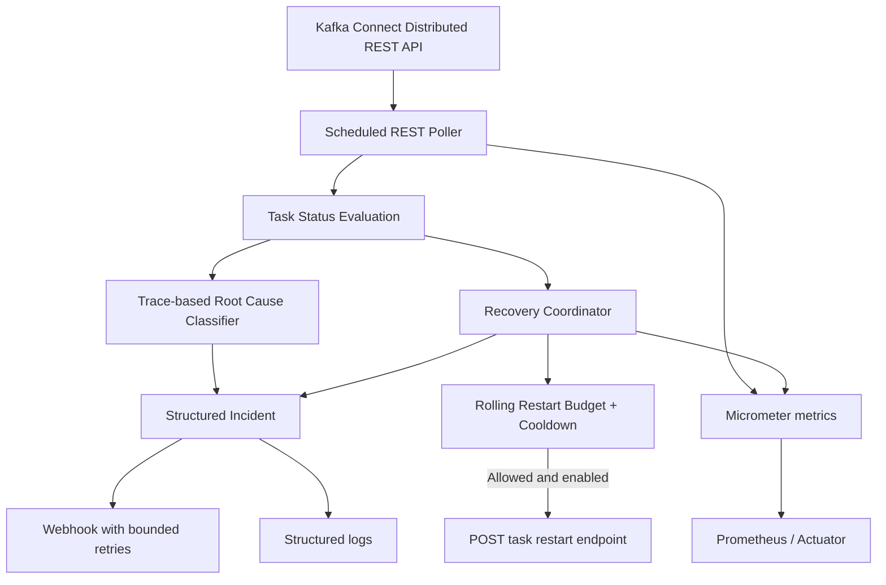

# Kafka Connect Ops Guardian

[](https://github.com/sajuu730/kafka-connect-ops-guardian/actions/workflows/ci.yml)
[](https://openjdk.org/projects/jdk/21/)
[](https://spring.io/projects/spring-boot)

**An operational reliability service for distributed Kafka Connect clusters.**

Kafka Connect Ops Guardian polls the Kafka Connect Distributed REST API, identifies failed tasks, classifies common failure causes, and coordinates safe, rate-limited recovery. It exposes operational metrics and sends structured incidents to a configurable webhook.

> **Project status: Early-stage implementation.** The latest verified CI run passed Maven verification and the Docker image build. Automated recovery is disabled by default. CI success validates the build and automated tests; it does not establish production readiness or prove behavior against every Kafka Connect deployment.

## Capabilities

- Scheduled polling of /connectors and /connectors/{name}/status.
- FAILED task detection and trace-based root-cause classification.
- Per-task rolling-window restart limits and cooldown for opt-in task restart.
- Structured incident webhook delivery with bounded exponential retries; structured logging when no webhook is configured.
- Isolation of connector-inspection and incident-delivery failures so one failure does not stop the rest of a polling cycle.
- Prometheus metrics and Spring Boot Actuator health endpoints.
- Unit tests for classification, REST API calls, monitoring, restart circuit-breaker behavior and webhook retries.
- Dockerfile, local Compose example, Kubernetes Deployment, Service and ConfigMap.
- GitHub Actions workflow for Maven verification and Docker image build.
- Separate version-tagged GHCR publishing workflow (not yet exercised by a published release).

## Architecture



## Safety defaults

Automated recovery is disabled by default. When enabled, a per-task rolling restart budget and cooldown prevent unbounded restart loops. The service records an accepted restart request; it does not treat that request as proof the task recovered. A later poll must observe the task's state.

## Technology

Java 21 · Spring Boot · Kafka Connect REST API · Micrometer · Prometheus · Docker · Kubernetes · JUnit 5 · Maven

## Quick start

Requirements: Java 21, Maven 3.9+, and Docker Engine with Compose plugin.

```bash
mvn --batch-mode verify
docker build -t kafka-connect-ops-guardian .
docker compose up --build
```

Check the service and the Connect endpoint:

```bash
curl http://localhost:8080/actuator/health
curl http://localhost:8080/actuator/prometheus
curl http://localhost:8083/connectors
```

To run against a separately running Connect REST endpoint:

```bash
CONNECT_URL=http://localhost:8083 mvn spring-boot:run
```

See [Configuration](docs/configuration.md) for environment variables and defaults.

## CI and verification

The GitHub Actions CI workflow runs Maven verification and builds the container image locally. A separate release workflow verifies the application and publishes version-tagged images to GHCR when a semantic version tag (for example v0.1.0) is pushed.

[View GitHub Actions runs](https://github.com/sajuu730/kafka-connect-ops-guardian/actions) · [Container release guide](docs/releasing.md)

## Important limitations

- Stalled-task detection is not implemented. Kafka Connect's standard status API does not provide record-level progress; a reliable progress signal must come from connector-specific metrics or another monitoring integration.
- Restart budgets are held in process memory. Run one Guardian replica while recovery is enabled; distributed coordination is required before active-active recovery.
- Webhook retries are synchronous and bounded. There is no durable outbox, so a process crash or prolonged endpoint outage can still lose an incident.
- Webhook authentication/signing and credential rotation are deployment responsibilities, not built-in features.
- The first version detects FAILED tasks. It does not automatically restart entire connectors or alter connector configuration.
- Root-cause classification is heuristic and should be treated as diagnostic assistance, not a definitive diagnosis.
- The Kubernetes image reference is a placeholder until a versioned image is published and verified in GHCR.

## Documentation

- [Architecture and limitations](docs/architecture.md)
- [Operations guide](docs/operations.md)
- [Configuration reference](docs/configuration.md)
- [Delivery roadmap](docs/roadmap.md)
- [Container release guide](docs/releasing.md)
- [Demo and screenshot capture guide](docs/demo-capture.md)

Never expose the Connect REST API publicly. Use TLS, authentication, network policies, secret references and restricted RBAC in production.

## License

MIT. See LICENSE.
