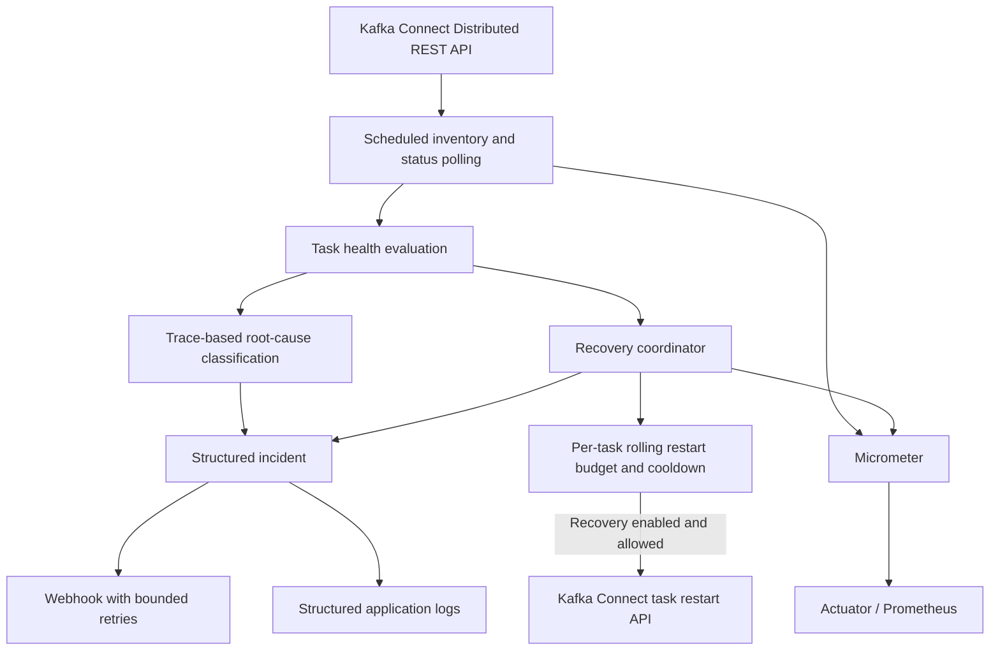

# Architecture

## System overview

## Observation flow

The scheduled monitor lists connectors from the Kafka Connect Distributed REST API, then reads each connector's status document. Task state and trace are used to identify failed tasks and classify common failure signatures. A failure inspecting one connector is isolated so the rest of the cluster is still inspected during that polling cycle.

## Recovery flow

Recovery is opt-in and disabled by default. When enabled, a failed task is passed through a per-task rolling-window restart budget and cooldown. An allowed action calls Kafka Connect's task restart endpoint. The service records the accepted restart request; it does not claim that the task recovered until a later poll observes a healthy state.

## Incident flow

Each failed task produces a structured incident containing timestamp, connector, task id, state, root-cause classification, original trace, action and detail. If a webhook URL is configured, the payload is POSTed as JSON with a bounded number of synchronous attempts and exponential backoff. Otherwise the incident is written as structured application logs. Incident publishing failures are isolated from other connector observations.

## Metrics

- `connector_auto_restarts_total`: accepted task restart requests.
- `connector_observation_failures_total`: failures while polling, coordinating recovery or publishing incidents.
- `connector_unhealthy_duration_seconds`: age of the oldest currently observed failed task.

Prometheus metrics are exposed through Spring Boot Actuator at `/actuator/prometheus`.

## Known limitations

- Kafka Connect's standard status API does not expose record-level progress. Stalled-task detection needs a connector-specific progress signal or external JMX/metrics integration and is not inferred from a RUNNING state alone.
- Restart budgets are in-memory and local to one Ops Guardian process. Run a single replica when recovery is enabled until a distributed coordination store is implemented.
- Webhook retries are synchronous and bounded; there is no durable outbox. A process crash or prolonged endpoint outage can still lose an incident.
- Webhook authentication is expected to be enforced by the deployment/network layer; built-in signing or credential rotation is not implemented.
- Connector-level FAILED state is reported via its failed tasks; connector restart is intentionally not automatic in this initial implementation.

## Verification status

The latest GitHub Actions workflow completed successfully with Maven verification and Docker image build. This validates the automated checks in CI. A live integration exercise against a representative Kafka Connect cluster and operational webhook is still a separate validation task.
